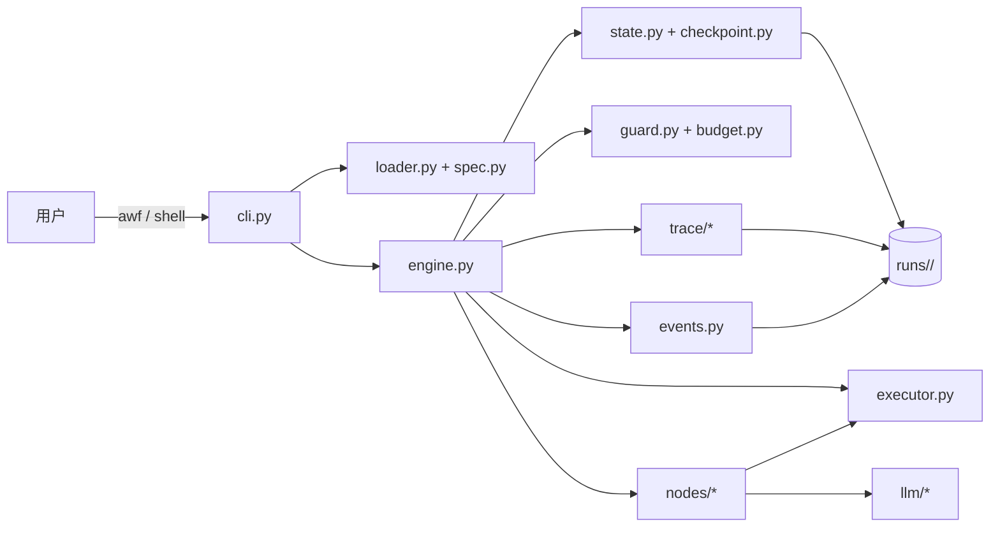

# AWEngine 使用与模块手册

> 适用版本：**awengine 1.1.0**  
> 面向读者：第一次接触本项目的使用者、准备录制演示视频的人、准备二次开发或阅读源码的人。  
> 文档结构：**第一部分：使用篇**，从安装到六个演示、排错和录屏；**第二部分：模块篇**，按层次介绍每个模块、关键接口、测试与扩展方式。

---

## 阅读指南

这份手册不是 README 的复制品，而是一条可以按顺序走完的学习路线：

| 你的目标 | 建议阅读 |
|---|---|
| 先跑起来 | 第 1～3 章 |
| 熟悉交互式界面 | 第 4 章 |
| 掌握全部命令 | 第 5 章 |
| 看懂运行结果和报告 | 第 6 章 |
| 准备课堂/视频演示 | 第 7、9 章 |
| 遇到报错 | 第 8 章 |
| 学会改工作流、加节点 | 第 10 章，第二部分第 24 章 |
| 阅读源码、理解设计 | 第二部分第 12～26 章 |

文中的命令默认在项目根目录执行：

```powershell
cd D:\Project\SoftwareProj\hmwk2\awengine
```

`awf` 是安装后的命令行入口；没有安装或不在 PATH 中时，用等价的：

```powershell
python -m awengine <子命令>
```

例如 `awf demo` 等价于 `python -m awengine demo`。

---

# 第一部分：使用篇

## 1. 先建立正确的心智模型

### 1.1 它解决什么问题

AWEngine 是一个**声明式、可验证、可恢复的多智能体工作流引擎**。它把“谁先做、谁交给谁、什么条件下循环、什么条件下结束”写在 YAML 中，把“具体怎么做”留给四类节点：

| 节点类型 | 适合做什么 | 例子 |
|---|---|---|
| `builtin` | 引擎自带的小动作 | `echo`、`set`、`write_file`、`apply_patch` |
| `python` | 项目内 Python 函数 | 自定义数据清洗、扫描、转换 |
| `process` | 任意语言实现的子进程 | Node、Go、Rust、Shell 脚本 |
| `llm_agent` | 需要模型推理的 Agent | coder、reviewer、fixer、writer |

一次运行是否成功，不由模型自称“我完成了”决定，而由**验证命令 + 隐藏测试**决定。模型可以提出补丁，但补丁必须经过沙箱应用和 pytest 验证；模型可以写评审意见，但报告会把意见、证据、修复和复审结果都记录下来。

### 1.2 六个核心概念

| 概念 | 一句话解释 | 在本项目中的位置 |
|---|---|---|
| Workflow | 一份 YAML，描述节点、边、收敛和验证 | [workflows/](workflows/) |
| Node | 一次执行单元，有输入、输出、重试和契约 | [awengine/nodes/](awengine/nodes/) |
| Artifact | 不可变的协作产物，例如 `patch`、`review`、`doc` | [awengine/contracts.py](awengine/contracts.py) |
| Message | 节点读取 artifact 时产生的 handoff 记录 | `state.json` 与 `events.jsonl` |
| Round | 从入口到一条**回边**（或 END）的执行区间 | [awengine/engine.py](awengine/engine.py) |
| Converge | 轮数、步数、成本、goal、progress 的停止规则 | [awengine/guard.py](awengine/guard.py) |

容易混淆的两点：

1. **round 不是节点步数**。普通正向边不会结束一轮；只有走过回边或到 END 才结束一轮。这样 `apply -> review` 这种正向节点不会被误判成轮末。
2. **success 不等于模型说了 success**。`terminal=success` 需要 goal 成立、streak 达标、轮数达标，并且 verify 通过（如果配置了 verify）。

### 1.3 一次运行发生了什么

```text
读取 YAML
  -> 创建 runs/<run_id>/ 与 manifest
  -> 复制 workdir 到沙箱
  -> 初始化 git 基线
  -> red_before 检查（可选）
  -> 进入第 1 轮
       -> 执行节点（失败按 retry 重试）
       -> 检查 contract
       -> 记录 state / artifact / message
       -> 选择第一条 when 为真的出边
       -> 如果走到回边或 END：执行 verify
       -> 记录 progress，判断 goal / limits / stall
  -> 未结束：escalate 或进入下一轮
  -> 结束：写 report、summary、mermaid、replay，返回退出码
```

详细的控制流图见 [docs/architecture.md](docs/architecture.md)；如果你只想快速理解，可以把它记成：

```text
YAML -> 调度 -> 沙箱执行 -> 验证 -> 收敛判断 -> 报告
```

### 1.4 成功、失败与退出码

一次运行最终会落到 `terminal` 之一：

| terminal | 含义 | 常见 reason |
|---|---|---|
| `success` | 目标达成且满足收敛条件 | `goal_met` |
| `blocked` | 被验证、守卫或契约阻止 | `verify_failed`、`cheat`、`node_failed` |
| `stalled` | 多轮没有进展 | `progress_stalled` |
| `exhausted` | 轮数/步数/成本等预算耗尽 | `rounds`、`steps`、`cost` |
| `exited` | `on_exhausted: fail` 时的退出 | `rounds` 等 |

CLI 退出码：

| 退出码 | 含义 |
|---|---|
| `0` | 成功，或 `awf demo` 中所有演示符合预期 |
| `1` | 未通过、被阻塞、预算耗尽等“业务失败” |
| `2` | 用法错误、YAML 规格错误、缺少输入 |
| `3` | 内部错误（未知异常） |
| `130` | 用户中断（Ctrl+C） |

负向演示 `guard` 和 `falsepass` **单独运行**时返回 1，这是刻意设计的；`awf demo` 会把它们当作预期结果，因此整体返回 0。

---

## 2. 环境准备

### 2.1 最低要求

| 项 | 要求 | 检查命令 |
|---|---|---|
| Python | 3.11、3.12 或 3.13 | `python --version` |
| git | 在 PATH 中，沙箱需要 `git init` 和 `git apply` | `git --version` |
| 操作系统 | Windows / Linux / macOS；本项目在 Windows 上开发与验证 | — |
| 网络 | 只有 `--live`/`--record` 需要；演示和测试完全离线 | — |

### 2.2 获取代码

```powershell
git clone https://github.com/TheBland73/AWengine.git
cd AWengine
```

如果你就在当前开发目录：

```powershell
cd D:\Project\SoftwareProj\hmwk2\awengine
```

### 2.3 创建虚拟环境（推荐）

```powershell
python -m venv .venv
.\.venv\Scripts\Activate.ps1
python -m pip install --upgrade pip
```

如果 PowerShell 阻止激活脚本，可以临时执行：

```powershell
Set-ExecutionPolicy -Scope Process -ExecutionPolicy Bypass
```

也可以不激活，直接使用 `.\.venv\Scripts\python.exe -m ...`。

### 2.4 安装依赖

| 安装方式 | 适合谁 | 包含内容 |
|---|---|---|
| `python -m pip install -e ".[dev,shell]"` | 开发者、要跑测试和交互式 shell | pytest、prompt_toolkit |
| `python -m pip install -e ".[llm,shell]"` | 只运行、使用真实模型 | openai、prompt_toolkit |
| `python -m pip install -e .` | 最小安装 | pydantic、PyYAML，无 openai |
| `python -m pip install -e ".[dev,llm,shell]"` | 全功能 | 全部可选依赖 |

演示和离线测试只需要最小安装；`prompt_toolkit` 只影响交互式 shell 的补全、历史和工具栏，没有它时 shell 会自动退回普通输入。

验证安装：

```powershell
awf --version
# awengine 1.1.0

python -m awengine --version
# awengine 1.1.0
```

如果提示 `awf` 不是内部或外部命令，说明 Scripts 目录不在 PATH；把下面目录加入 PATH，或直接用 `python -m awengine`：

```text
C:\Users\<你>\AppData\Local\Programs\Python\Python313\Scripts
```

### 2.5 API key 与三种模型模式

`--fake`、`--live`、`--record` 是三种互斥模式：

| 模式 | 是否联网 | 是否需要 API key | 用途 |
|---|---|---|---|
| `--fake` | 否 | 否 | 回放 `tests/cassettes/`，演示和 CI 的默认方式 |
| `--live` | 是 | 是 | 真正调用 DeepSeek/OpenAI 兼容接口 |
| `--record` | 是 | 是 | 调用并把响应写成新的 cassette |
| 不写模式 | 自动 | 有 key 则 live，否则 fake | 日常使用最方便，但录屏建议显式写 `--fake` |

配置 key（PowerShell 当前会话）：

```powershell
$env:DEEPSEEK_API_KEY = "sk-..."
# 或
$env:OPENAI_API_KEY = "sk-..."
```

不要把 key 写进 YAML、README、`runs/` 或 Git。事件写入前会脱敏 `api_key`、`authorization`、`token` 等字段，但最安全的做法仍然是不把 key 放进项目目录。

### 2.6 Windows 终端建议

录屏和日常使用建议：

```powershell
chcp 65001
$env:PYTHONUTF8 = "1"
```

设置 UTF-8 可以避免旧代码页把 `¥` 等字符显示成乱码。报告文件本身是 UTF-8；如果控制台仍显示异常，优先检查终端字体和代码页，而不是报告文件。

---

## 3. 五分钟跑通

### 3.1 一条命令运行全部演示

```powershell
awf demo
```

你会看到类似输出（run id 和时间会不同）：

```text
[ok] hello: success/goal_met (no failure class) - three-node YAML pipeline
        report: ...\runs\20261022-120223-hello\report.md
[ok] bugfix: success/goal_met (no failure class) - coder -> reviewer -> fixer loop (three agents)
        report: ...\runs\20261022-120223-bugfix\report.md
[ok] docsync: success/goal_met (no failure class) - inline YAML agents, no Python module
[ok] guard: blocked/cheat (F-STOP-EARLY) - test-file immutability guard (expected hard stop)
[ok] falsepass: blocked/verify_failed (F-VERIFY-FALSEPASS) - visible tests pass, holdout fails (expected block)
[ok] recover: success/goal_met (no failure class) - failed patch routed to a recovery edge
summary: 6/6 demos matched expectations
```

这一条命令同时验证了：顺序流程、三 Agent 循环、内联 Agent、守卫拦截、假通过检测、补丁失败恢复。

### 3.2 查看运行列表

```powershell
awf ls
```

输出包含 run id、工作流、terminal、reason、轮数、成本和创建时间。找到最近一次 bugfix 的 run id，例如：

```text
20261022-120223-bugfix
```

### 3.3 查看一次运行

```powershell
awf show 20261022-120223-bugfix
```

关注三段：

- `history`：每个节点按执行顺序的记录；
- `artifacts`：`patch` 和 `review` 的内容与摘要；
- `messages`：`coder -> apply`、`review -> fix` 等 handoff。

交互式 shell 中可以省略 id：

```text
awf> show last
```

### 3.4 打开报告与回放

```powershell
awf report 20261022-120223-bugfix
awf replay 20261022-120223-bugfix --open
```

也可以直接打开：

```text
runs/<run_id>/report.md
runs/<run_id>/replay.html
runs/<run_id>/flow.mmd
runs/<run_id>/sequence.mmd
```

### 3.5 先跑通，再改

第一次使用时不要急着改代码。建议顺序：

1. `awf demo` 看六个结果；
2. `awf show <bugfix-id>` 看协作；
3. 打开 `report.md` 看 Issues 和 Collaboration；
4. `awf validate workflows/bugfix.yaml` 看静态图；
5. 再开始改 YAML 或节点。

---

## 4. 交互式 shell 完全指南

### 4.1 启动方式

```powershell
awf
```

当 stdin 和 stdout 都是终端时，`awf` 会进入交互式 shell；显式启动：

```powershell
awf shell
```

如果终端不支持 prompt_toolkit、或你想在脚本/受限终端中使用：

```powershell
awf shell --plain
```

如果希望无参数 `awf` 永远只打印帮助而不进入 shell：

```powershell
$env:AW_NO_SHELL = "1"
```

### 4.2 首次进入会看到什么

```text
awengine 1.1.0  interactive shell
project  D:\Project\SoftwareProj\hmwk2\awengine
runs     runs  (0 runs)
model    offline: recorded cassettes
type `help` for commands, `quit` to exit

awf>
```

| 行 | 含义 |
|---|---|
| `project` | 自动找到的包含 `workflows/` 的项目根目录 |
| `runs` | 当前运行目录；默认 `runs/`，可用 `AW_RUNS` 修改 |
| `model` | 检测到 API key 时显示 live key detected，否则 offline |

shell 会自动切换到项目根目录，因此在子目录中启动也能正常找到 `workflows/` 和 `fixtures/`。

### 4.3 一键演示命令

在 `awf>` 后直接输入演示名：

| 输入 | 等价的非交互命令 |
|---|---|
| `hello` | `awf run hello --fake --workdir fixtures/calcfix -i name=world` |
| `bugfix` | `awf run bugfix --fake --workdir fixtures/calcfix` |
| `docsync` | `awf run docsync --fake --workdir fixtures/docsync` |
| `guard` | `awf run guard` |
| `falsepass` | `awf run falsepass --workdir fixtures/falsepass` |
| `recover` | `awf run recover --workdir fixtures/calcfix` |

其他常用输入：

```text
demo                    运行全部六条演示
demo --only bugfix      只运行 bugfix
bugfix --live           使用真实模型运行三 Agent 流程
hello -i name=Alice     覆盖输入
show last               查看最近一次运行
last                    同上
report last             重新生成最近一次报告
replay last             重新生成最近一次回放
explain last            解释最近一次为什么停止
```

`bugfix --live` 会自动去掉预设里的 `--fake`，但保留 `--workdir`。没有 API key 时，live 会失败；录屏建议始终使用默认的离线预设。

### 4.4 斜杠命令、别名和补全

以下两种写法等价：

```text
/demo
demo
```

`/run`、`/show`、`/help` 等也都可以。常用别名：

| 输入 | 等价 |
|---|---|
| `list`、`runs`、`status` | `ls` |
| `h`、`?` | `help` |
| `q`、`exit` | `quit` |
| `ver` | 版本 |
| `last` | `show last` |

安装 `prompt_toolkit` 后支持：

- Tab 补全命令、工作流名和最近的 run id；
- 上下键浏览历史；
- 历史文件默认在 `~/.awf/history`；
- 底部工具栏提示常用命令；
- `Ctrl+C` 取消当前输入，`Ctrl+D` 退出。

未安装 `prompt_toolkit` 时，shell 自动使用普通 `input()`，命令行为不变，只是没有补全和工具栏。

### 4.5 shell 的边界

shell 只是**参数改写层**：它把一行文本翻译成与 `awf` 完全相同的 argv，然后调用同一个 CLI。因此：

- 不会出现“shell 里能跑、命令行不能跑”的隐藏逻辑；
- 脚本、CI、视频中的非交互命令仍然是一等公民；
- shell 不负责解析 YAML、执行节点或写报告，这些都在 CLI/engine 中。

---

## 5. CLI 参考

### 5.1 通用参数

大多数子命令都支持：

| 参数 | 作用 |
|---|---|
| `--runs DIR` | 运行目录，默认 `runs/`，也可用 `AW_RUNS` |
| `--no-color` | 关闭 ANSI 颜色 |
| `--quiet` | 只显示警告和最终停止行 |
| `-v`, `--verbose` | 显示 LLM 调用、工具、上下文事件 |
| `--json-events` | 把事件以 JSONL 写到 stdout（`run`） |

注意：这些参数写在**子命令之后**：

```powershell
awf run bugfix --fake --runs runs\demo
```

### 5.2 `awf run`

```powershell
awf run <workflow> [选项]
```

| 选项 | 说明 |
|---|---|
| `-i KEY=VALUE` | 输入，可重复 |
| `--input-file FILE` | JSON 对象文件；值会转成字符串 |
| `--workdir DIR` | 复制到沙箱的源目录，默认 `.` |
| `--spec PATH` | 明确指定 workflow 文件 |
| `--disable NODE` | 在加载期旁路节点，可重复 |
| `--fake` | 回放 cassette |
| `--live` | 调用真实 provider |
| `--record` | 调用并写入 cassette |
| `--cassettes DIR` | cassette 目录 |
| `--max-rounds N` | 覆盖 `converge.rounds.max` |
| `--max-steps N` | 覆盖 `converge.steps.max` |
| `--max-cost CNY` | 硬成本上限 |
| `--no-verify` | 跳过验证，仅调试用 |
| `--dry-run` | 只打印计划，不创建运行目录 |

示例：

```powershell
# 离线跑三 Agent 修复
awf run bugfix --fake --workdir fixtures/calcfix

# 指定输入
awf run hello --fake --workdir fixtures/calcfix -i name=Alice

# 只看计划
awf run bugfix --dry-run

# 旁路 coder，观察 plan 直连 apply（dry-run 不会真正执行）
awf run bugfix --fake --workdir fixtures/calcfix --disable coder --dry-run

# 限预算
awf run bugfix --fake --workdir fixtures/calcfix --max-cost 0.01
```

`--workdir` 的语义是**复制**：引擎把源目录复制到 `runs/<run_id>/workdir/`，所有写入和补丁都发生在副本里；原始 `fixtures/calcfix` 不会被修改。这是可以反复演示、反复测试的关键。

### 5.3 三种模型模式的判断顺序

不写 `--fake/--live/--record` 时：

1. 读取 workflow 的 `defaults.model`；
2. 查找对应 API key；
3. 有 key -> live；没有 -> fake，并打印警告；
4. fake 下如果 cassette 目录为空，会警告后续 LLM 节点可能 `CassetteMiss`。

录屏和课堂演示建议显式写 `--fake`，这样不会因为别人的机器上有 key 而意外联网。

### 5.4 `awf resume`

```powershell
awf resume <run_id> [--fake|--live|--record] [--cassettes DIR]
```

从 `state.json` 保存的 `cursor` 继续，不从头开始。恢复时会校验：

- run 是否已经 terminal；
- workflow 的 `spec_hash` 是否与开始时一致；
- manifest 中记录的 fake/record/live、cassette 目录、项目目录和 max_steps。

只有未完成的 run 才能恢复。若 workflow 改过，会报 `E-STATE-SPEC-MISMATCH`，此时应恢复原 workflow 或新建 run。

### 5.5 查看与诊断命令

| 命令 | 用途 | 常用参数 |
|---|---|---|
| `awf show <id>` | 状态、history、artifacts、messages | `--events N`、`--json` |
| `awf explain <id>` | 人话解释停止原因和建议 | `--json` |
| `awf trace <id>` | 打印事件流 | `-n N`、`--follow` |
| `awf report <id>` | 重新生成 `report.md`/`summary.json` | — |
| `awf replay <id>` | 重新生成并打开 `replay.html` | `--open` |
| `awf ls` | 列出运行 | `--json` |

`show` 适合看“结果是什么”，`trace` 适合看“过程发生了什么”，`explain` 适合看“为什么停在这里”。

### 5.6 其他命令

| 命令 | 用途 |
|---|---|
| `awf validate <workflow> [--graph]` | 校验 YAML；`--graph` 输出 Mermaid |
| `awf nodes [--json]` | 列出内置、包内和项目内可发现节点 |
| `awf new <name> --dir <path>` | 创建可离线运行的项目脚手架 |
| `awf demo [--only NAME] [--json]` | 运行六条演示并校验预期 |

`awf new` 生成的工作流、节点、测试、README 和 pyproject 都是可直接运行的；生成的测试使用 `ScriptedLLM`，不需要网络。

### 5.7 退出码速查

```text
0    success / demo 全部符合预期
1    blocked、stalled、exhausted、goal_not_met 等
2    E-* 用法或规格错误
3    未捕获内部异常
130  Ctrl+C
```

在 shell 中，非 0 退出不会终止会话，只会打印 `[exit N]`，可以继续输入下一条命令。

---

## 6. 从一次运行到一份报告

### 6.1 运行目录

```text
runs/<run_id>/
  manifest.json      # 工作流、spec hash、输入、workdir、运行选项
  state.json         # 最新检查点，可恢复
  state.json.prev    # 上一个检查点，损坏时回退
  events.jsonl       # append-only 事件流
  report.md          # 人读报告
  summary.json       # 机读摘要
  flow.mmd           # 工作流图
  sequence.mmd       # 事件时序图
  replay.html        # 自包含回放播放器
  workdir/           # 本次运行的沙箱副本
  .lease             # 运行锁租约（运行期间）
```

`workdir/` 是副本，不是原目录。演示结束后可以放心删除 `runs/`；它只影响历史记录，不影响源码和测试。

### 6.2 报告导读

以一次 bugfix 报告为例，章节含义如下：

| 章节 | 回答的问题 |
|---|---|
| `Verdict` | 最终通过没有？verify 级别、命令、holdout、red-before、Agent 意见 |
| `Why it stopped` | terminal、reason、failure class、计数器、goal、verify 结果 |
| `Flow` | Mermaid 流程图，含条件边和 verify 节点 |
| `Collaboration timeline` | 谁把哪个 artifact 交给了谁，发生在第几轮 |
| `Nodes` | 每个节点的状态、耗时、token、成本、artifact、错误 |
| `Issues` | review 提出的问题、证据、严重级别、是否被后续 review 解决 |
| `Progress` | 每轮的 progress key/value/metric，用于观察停滞 |
| `Cost` | 按模型汇总调用次数、输入/输出 token、成本 |
| `Artifacts` | 最终 artifact 的 id、类型、生产者、轮次、digest |
| `Reproduce` | 复现和回放命令 |

bugfix 报告里最关键的一行往往是：

```text
| 1 | resolved | blocker | R1-1 | calc.py:11 | mul() adds instead of multiplying ... | ... | review |
```

它说明 reviewer 在第一轮发现了问题，fixer 修复后，`review_final` 把同一个问题标为 `resolved`。如果只看最终 artifact，你会以为一切顺利；报告的 Issues 表保留了两轮评审的差异，这正是“协作过程可见”的价值。

### 6.3 `summary.json`、`flow.mmd`、`sequence.mmd`

- `summary.json`：机器可读的 terminal、reason、failure_class、counters、verify、artifacts、usage 等，适合做批量评估。
- `flow.mmd`：来自 spec 的流程图，适合贴进文档；`awf validate --graph` 也能直接打印。
- `sequence.mmd`：来自真实事件流的时序图，适合展示“谁在什么时候和谁交互”。

### 6.4 `replay.html`

自包含单文件，不需要服务器。支持：

- Play/Pause；
- 上一步/下一步；
- 进度条拖动；
- 键盘方向键/空格；
- 当前节点高亮。

录制视频时，`replay.html` 是最直观的“过程证据”：它比静态报告更能展示节点顺序、重试和 handoff。

### 6.5 `show` / `explain` / `trace` 的分工

```powershell
# 结果与结构
awf show <id>
awf show <id> --events 20
awf show <id> --json

# 为什么停止
awf explain <id>
awf explain <id> --json

# 事件流
awf trace <id> -n 50
awf trace <id> --follow
```

调试顺序建议：

```text
先看 terminal/reason/failure_class
  -> 再看 history 里第一个 fail
  -> 用 trace 找 node_end / node_retry / verify / converge_eval
  -> 用 show 看 artifact 和 message
  -> 最后才怀疑模型，优先怀疑输入、路径、环境或验证配置
```

---

## 7. 六个演示逐个上手

六个演示都可以单独运行。`awf demo --only NAME` 是最短的入口；下面给出等价的非交互命令和观察重点。

### 7.1 `hello`：最小顺序流程

```powershell
awf run hello --fake --workdir fixtures/calcfix -i name=world
```

预期：

```text
run <id>: success (goal_met)
rounds 1, steps 3...
```

三个节点：

```text
plan -> greet -> wrap
```

观察点：

- `plan` 是 builtin `echo`，把输入拼进消息；
- `greet` 是模块 Agent，返回 `greeting` 和 `words`；
- `wrap` 是 builtin `set`，设置 `ok`；
- goal 是 `greet.words >= 1`，不是“模型说完成了”。

这是理解“YAML 控制流 + 节点实现 + goal”最短的路径。

### 7.2 `bugfix`：三 Agent 修复循环

```powershell
awf run bugfix --fake --workdir fixtures/calcfix
```

先看流程图：

```text
plan -> coder -> apply -> review --(blockers == 0)--> END
                           |
                           +--(blockers > 0)--> fix -> apply_fix -> review_final
                                                                        |
                                                       review_final --(0)--> END
                                                       review_final --(>0)--> fix
```

执行顺序（离线 cassette 固定）：

```text
plan -> coder -> apply -> review -> fix -> apply_fix -> review_final
```

观察点：

| 节点 | 发生了什么 | 证据 |
|---|---|---|
| `coder` | 读取仓库，返回修复 `add()` 的 patch | `patch` artifact |
| `apply` | 在沙箱 `git apply` | `history` 中 `apply ok` |
| `review` | 发现 `mul()` 也坏了，返回 blocker `R1-1` | `review` artifact、Issues 表 |
| `fix` | 根据 review 修复 `mul()` | 第二个 `patch` |
| `apply_fix` | 应用第二个 patch | `apply_fix ok` |
| `review_final` | 复审通过，blocker=0 | `review` 被最终版本覆盖，但报告保留两轮 |

报告里的 `Collaboration timeline` 应该出现：

```text
coder -> apply   consume:patch
coder -> review  consume:patch
review -> fix    consume:review
fix -> apply_fix consume:patch
fix -> review_final consume:patch
```

讲解时可以强调：**reviewer 不是走过场**。第一轮 review 找到了 coder 漏掉的 `mul()`，fixer 修完，`review_final` 才允许结束；如果直接看最终代码，这个过程会被掩盖。

### 7.3 `docsync`：完全内联的三 Agent

```powershell
awf run docsync --fake --workdir fixtures/docsync
```

流程：

```text
plan -> analyst -> writer -> write -> editor -> END
```

特点：

- `analyst`、`writer`、`editor` 的 system/task/tools/artifacts **全部写在 YAML** 中，没有 Python 模块；
- `writer` 产出 Markdown，`write` 用 `write_file` 写到沙箱的 `NOTES.md`；
- `editor` 读取 `doc` artifact 做最后检查；
- verify 检查 `NOTES.md` 是否包含约定关键词。

查看产物：

```powershell
$run = Get-ChildItem runs\*docsync* -Directory | Sort-Object LastWriteTime -Descending | Select-Object -First 1
Get-Content (Join-Path $run.FullName 'workdir\NOTES.md')
```

这是“扩展性”最直观的证据：新增一个业务协作流程，不需要改引擎。

### 7.4 `guard`：修改测试文件被硬拦截

```powershell
awf run guard
```

预期：

```text
run <id>: blocked (cheat)
failure class: F-STOP-EARLY
```

`plan` 构造一个会修改 `tests/test_calc.py` 的 patch，`apply_patch` 在 `git apply` 之前调用 `patch_violations()`，发现受保护路径，返回 `E-GUARD` 和 `cheat=True`；引擎直接 blocked，不执行补丁。

讲解点：

- 保护不是靠提示词，而是代码路径；
- 受保护路径包括 `tests/`、`tests_holdout/`、`conftest.py`、`pytest.ini`、`test_*.py` 等；
- 违规是**硬停止**，不是“模型再试一次”。

### 7.5 `falsepass`：可见测试通过，隐藏测试失败

```powershell
awf run falsepass --workdir fixtures/falsepass
```

预期：

```text
run <id>: blocked (verify_failed)
failure class: F-VERIFY-FALSEPASS
```

场景：

- 可见测试只测 `add()`，`add()` 是正确的，所以可见测试通过；
- holdout 测 `mul()`，`mul()` 仍是错的，所以隐藏测试失败；
- verify 判定为 false pass，而不是 success。

讲解点：

- 只跑“公开测试”不足以证明修复；
- holdout 只在 verify 阶段注入 `tests_holdout/`，Agent 工作期间不可见；
- `red_before: true` 还要求未修改副本上验证先失败，防止拿本来就绿的测试冒充修复。

### 7.6 `recover`：补丁失败后走恢复边

```powershell
awf run recover --workdir fixtures/calcfix
```

预期：

```text
run <id>: success (goal_met)
attempts 1
```

场景：

- `plan` 构造一个无效补丁；
- `apply` 失败，`apply.applied` 为 false；
- 条件边把流程送到 `fallback`，而不是直接终止；
- `fallback` 设置 `recovered=true`，goal 成立。

讲解点：

- 失败节点不一定等于整个 run 失败；
- 条件边可以表达“失败后恢复”；
- 表达式里不要写 `apply.applied == false`：YAML 会把 `false` 解析成缺失变量；正确写法是 `not apply.applied`。

### 7.7 六个演示对照表

| 演示 | 主要路径 | 预期 terminal/reason | 讲解关键词 |
|---|---|---|---|
| `hello` | 顺序 + goal | success/goal_met | 最小闭环 |
| `bugfix` | 三 Agent + 回边 + verify | success/goal_met | 协作、评审、修复 |
| `docsync` | 内联 Agent + 文件 | success/goal_met | YAML 即流程 |
| `guard` | 保护路径 | blocked/cheat | 确定性安全 |
| `falsepass` | 可见/隐藏测试 | blocked/verify_failed | 防假通过 |
| `recover` | 条件边 | success/goal_met | 失败恢复 |

`awf demo` 会把六个结果与 `awengine/demo.py` 中的期望比较；任何一条不符合就返回非 0。测试 [tests/test_demo.py](tests/test_demo.py) 也固定了这个集合。

---

## 8. 常见失败与排查

### 8.1 先看三个地方

```powershell
awf explain <id>
awf show <id>
awf trace <id> -n 40
```

优先确认：

1. `terminal` / `stop_reason` / `failure_class`；
2. `history` 中第一个 `fail` 的 `error`；
3. `events.jsonl` 中 `node_end` 的 `data.error`。

### 8.2 常见错误表

| 现象 | 根因 | 处理 |
|---|---|---|
| `CassetteMiss` | `--fake` 找不到请求对应的 cassette；提示词、workdir、repo map 或输入变了 | 删除旧 cassette，重新 `--record`；或显式指定 `--cassettes` |
| `E-LLM-NOKEY` | `--live`/`--record` 但没有 key | 设置 `DEEPSEEK_API_KEY`/`OPENAI_API_KEY`，或改用 `--fake` |
| `No module named pytest` | 沙箱命令用的 Python 环境没有 pytest | 在当前 Python 中安装 `[dev]`；确认 `APPDATA` 等环境可用 |
| `SPEC_VERIFY_HOLDOUT_MISSING` | holdout 相对路径找不到 | 相对 workflow 文件目录放置，或改为正确的相对路径 |
| `error: patch failed` | diff 上下文/行号不匹配 | 检查 `events` 中的 stderr；确保 diff 是 unified diff，必要时用 `git diff` 生成 |
| `F-VERIFY-FALSEPASS` | 可见测试通过但 holdout 失败 | 这是有价值的失败；检查修复是否覆盖 holdout 场景 |
| `verify_weak` | 未修改副本上 verify 已经通过 | 修测试或换验证命令；`red_before` 需要先红后绿 |
| `F-STOP-EARLY` + `cheat` | 补丁触碰受保护路径 | 不要修改测试；只改业务文件 |
| `RunLocked` | 同一 run 有活跃租约 | 等原进程结束；确认无进程后再删 `.lease` |
| `state.json` 损坏 | 写入中断/手工修改 | `state.json.prev` 会自动回退；不要手改状态 |
| `E-STATE-SPEC-MISMATCH` | resume 时 workflow 已改 | 恢复原 workflow 或新建 run |
| `E-SPEC-*` | YAML 规格错误 | 看错误中的文件名/行号；`awf validate` 先校验 |
| `awf` 不识别 | Scripts 不在 PATH | 用 `python -m awengine`，或把 Scripts 加入 PATH |
| 终端 `¥` 显示异常 | GBK 代码页 | `chcp 65001`；报告文件仍是 UTF-8 |

### 8.3 修复 cassette 的完整流程

```powershell
# 1. 确认要改的是提示词或工作目录
# 2. 删除旧 cassette（或整个目录，谨慎）
Remove-Item tests\cassettes\*.json

# 3. 设置 key，重新录制
$env:DEEPSEEK_API_KEY = "sk-..."
awf run bugfix --record --workdir fixtures/calcfix

# 4. 再离线验证
awf run bugfix --fake --workdir fixtures/calcfix
```

cassette 的 key 由 model、messages、tools、temperature、max_tokens 共同决定；只改一个标点也可能导致 miss。录制后用 `awf demo` 做整体回归。

### 8.4 调试 `process` 节点

`type: process` 通过 stdin/stdout JSON 通信，不经过 shell。常见问题：

- 子进程把日志写到 stdout，导致 JSON 解析失败——日志应写 stderr；
- 命令路径/working directory 不对——命令在沙箱 cwd 下执行；
- 返回了非零退出码——引擎会把它当作节点失败；
- 忘记输出 `status` 字段。

最小协议：

```json
{"status": "ok", "output": {"answer": 42}, "artifacts": []}
```

### 8.5 调试 LLM 节点

```powershell
awf run bugfix --fake --workdir fixtures/calcfix -v
```

`-v` 会显示：

- `llm_call`：模型、step、token、成本、prompt 前缀；
- `tool_call`：读取/搜索/运行命令；
- `context_action`：上下文裁剪。

如果模型输出不是合法 JSON，节点会失败；先检查 prompt 是否要求返回 JSON，再检查 `parse_json_response` 能接受的围栏格式。

---

## 9. 演示视频录制

这一章给出一套可以直接照做的录屏方案。更细的逐分钟脚本和讲稿见 [Demonstration.md](Demonstration.md)；本节补上“为什么这样录”和“如何避免翻车”。

### 9.1 录屏目标

一条合格的演示视频应该让观众在 8 分钟内看到：

1. 项目能装、能跑；
2. 多 Agent 真的在协作，而不是一个 Agent 假装；
3. 有分支、有循环、有验证；
4. 失败被明确处理，不是“模型说成功”；
5. 结果可复现、可检查（报告/回放）。

### 9.2 录制前准备

| 项 | 建议 |
|---|---|
| 目录 | 克隆到短路径，例如 `D:\demo\AWengine`，避免长路径和中文路径 |
| 终端 | Windows Terminal + PowerShell 7；字号 16～18；窗口 1920×1080 |
| 编码 | `chcp 65001`，`$env:PYTHONUTF8=1` |
| 运行目录 | 先删除 `runs/`，让画面干净 |
| 模式 | 全部用 `--fake`；不要依赖网络和 API key |
| 录制 | OBS 录制窗口或全屏；先试录 10 秒检查字体/颜色 |
| 剪辑 | 命令之间可暂停；不需要一镜到底 |
| 安全 | 不打开 `.env`，不显示 key，不把个人路径放进画面 |

预检命令：

```powershell
cd D:\demo\AWengine
chcp 65001
python -m pip install -e ".[dev,shell]"
awf --version
awf demo
awf ls
```

如果 `awf demo` 不是 6/6，先不要录。

### 9.3 八分钟分镜

| 时间 | 画面 | 操作 | 讲解要点 |
|---|---|---|---|
| 0:00–0:30 | 项目根目录 | `awf --version`，展示 README 顶部 | 一句话：声明式、可验证、可恢复；YAML 控制流，Python/进程/LLM 做节点 |
| 0:30–1:30 | 终端 | `awf demo` | 六条演示全部离线；指出 success 与两个 expected blocked |
| 1:30–2:30 | 终端 + report | 单独跑 `hello`；`awf show last` | 最小闭环：plan -> greet -> wrap；goal 由 verify/字段决定 |
| 2:30–4:30 | 终端 + report | `bugfix`；`awf show <id>`；打开 report | 三 Agent：coder 产 patch，reviewer 找 R1-1，fixer 修 mul，review_final 复审 |
| 4:30–5:30 | 终端 + NOTES.md | `docsync`；查看 `workdir/NOTES.md` | 三个 Agent 完全写在 YAML；展示扩展性 |
| 5:30–6:30 | 终端 | `guard` 和 `falsepass` | 预期失败：修改测试被硬拦截；公开测试过、隐藏测试失败 |
| 6:30–7:15 | 终端 | `recover`；`awf explain <id>` | 失败补丁走恢复边；讲 failure class 与条件边 |
| 7:15–8:00 | 浏览器 | 打开 `replay.html`；拖动/播放 | 回放展示节点顺序、handoff、重试；收尾 |

### 9.4 逐段命令与预期

**0:00–1:30 开场与总览**

```powershell
awf --version
awf demo
```

预期最后一行：`summary: 6/6 demos matched expectations`。这里不要逐条解释六个演示，只说明“有成功也有刻意失败”。

**1:30–2:30 hello**

```powershell
awf run hello --fake --workdir fixtures/calcfix -i name=world
awf show last
```

预期 `success (goal_met)`，3 步。重点展示 `history` 和 `artifacts`，不要陷入代码。

**2:30–4:30 bugfix**

```powershell
awf run bugfix --fake --workdir fixtures/calcfix
awf show last
```

报告里重点指：

- `Collaboration timeline` 的五条 handoff；
- `Issues` 里的 `R1-1` 和 `resolved`；
- `Verification level L4`、`Holdout: passed`、`Red before: True`；
- `History` 的顺序是 `plan, coder, apply, review, fix, apply_fix, review_final`。

讲解词可以这么说：

> coder 先修了 add，但 reviewer 发现 mul 也被改坏了，所以第一轮不能结束；fixer 根据评审修复 mul，review_final 复审通过，验证命令和隐藏测试才把这次运行判为成功。

**4:30–5:30 docsync**

```powershell
awf run docsync --fake --workdir fixtures/docsync
$run = Get-ChildItem runs\*docsync* -Directory | Sort-Object LastWriteTime -Descending | Select-Object -First 1
Get-Content (Join-Path $run.FullName 'workdir\NOTES.md')
```

展示“不用写 Python 模块也能定义三个 Agent”。重点指 YAML 里的 `config.system`、`config.task`、`artifacts`。

**5:30–6:30 guard / falsepass**

```powershell
awf run guard
awf run falsepass --workdir fixtures/falsepass
```

两个都会返回 1。提前说明“这是预期的负向演示”，避免观众误以为项目失败。分别解释：

- guard：改测试文件被代码层拦截，不是模型自觉；
- falsepass：公开测试过、隐藏测试失败，说明验证不是形式主义。

**6:30–7:15 recover**

```powershell
awf run recover --workdir fixtures/calcfix
awf explain last
```

强调 `attempts 1`、条件边和 `F-STOP-EARLY`/恢复的区别。

**7:15–8:00 replay**

```powershell
awf replay last --open
```

在浏览器中播放/拖动，指出节点高亮和 handoff。最后回到 README 或仓库首页收尾。

### 9.5 六十秒短片版

如果只要一条短视频：

```text
0–10s   awf --version + 一句话定位
10–25s  awf demo，镜头停在 6/6
25–40s  bugfix 运行 + 报告 Collaboration/Issues
40–50s  guard / falsepass 的 blocked（字幕说明是预期）
50–60s  replay.html + 仓库地址
```

命令：

```powershell
awf demo
awf run bugfix --fake --workdir fixtures/calcfix
```

短片不需要讲清楚每个模块，只要让观众记住三点：**真的协作、真的验证、真的可恢复**。

### 9.6 录制讲稿（可直接念）

> 这是 AWEngine，一个声明式、可验证、可恢复的多智能体工作流引擎。  
> 流程写在 YAML 里，节点可以是 Python 函数、子进程、内置动作或 LLM Agent。  
> 一次运行是否成功，不由模型自己宣布，而由验证命令和隐藏测试决定。  
> `awf demo` 离线运行六条流程：顺序、三 Agent 修复、内联 Agent、守卫、防假通过、失败恢复。  
> 这里的三 Agent 流程中，coder 先提交补丁，reviewer 发现问题，fixer 修复，review_final 复审通过；报告保留了每一轮评审和 handoff。  
> 最后，replay 可以逐节点回放整个过程。所有演示都可以离线复现。

### 9.7 录制检查清单

- [ ] `awf demo` 输出 6/6；
- [ ] `awf --version` 是 1.1.0；
- [ ] 删除旧 `runs/`，画面干净；
- [ ] 终端 UTF-8，字体清晰；
- [ ] 不显示 API key、个人目录、聊天窗口；
- [ ] 负向演示先说明“预期返回 1”；
- [ ] 报告提前打开一次，确认路径和内容；
- [ ] 录完后检查音画同步、命令输出没有被截断；
- [ ] 视频描述里放仓库链接和 `awf demo` 命令。

### 9.8 常见翻车点

| 问题 | 预防 |
|---|---|
| `CassetteMiss` 打断录制 | 录制前跑一次 `awf demo`；不要临时改 prompt |
| 终端中文乱码 | `chcp 65001`，使用 UTF-8 字体 |
| 路径太长/含空格 | 用 `D:\demo\AWengine` |
| 命令输出滚动太快 | 分段录，后期剪；或 `--quiet` |
| 负向演示被误认为失败 | 画面字幕/口播说明 expected block |
| 忘记打开报告 | 预先在浏览器/编辑器打开，录制时切换 |
| 视频没有重点 | 按 9.3 分镜，每段只讲一个能力 |

---

## 10. 从会用到掌握：练习路线

### 10.1 Level 1：运行与观察

- [ ] 跑通 `awf demo`；
- [ ] 用 `awf ls` 找到 bugfix，`awf show` 看 history；
- [ ] 打开 `report.md`，找到 Issues 的 `R1-1`；
- [ ] 打开 `replay.html`，播放一遍；
- [ ] 用 `awf explain` 解释 guard 为什么 blocked。

### 10.2 Level 2：改 YAML

从 [workflows/hello.yaml](workflows/hello.yaml) 开始：

1. 把 `converge.goal` 改成 `greet.words >= 2`；
2. 运行 `awf run hello --fake --workdir fixtures/calcfix -i name=world`；
3. 观察是否变成 `blocked/goal_not_met`；
4. 再改回来，确认恢复 success。

练习目标：理解 goal 是表达式，不是注释。

### 10.3 Level 3：加一个 Python 节点

在 `nodes/` 下新建 `nodes/wordcount.py`：

```python
from awengine.contracts import NodeResult


def run(ctx):
    text = str(ctx.inputs.get("text", ""))
    words = len(text.split())
    return NodeResult(status="ok", output={"words": words})
```

在 YAML 中引用：

```yaml
count:
  type: python
  impl: nodes.wordcount
```

运行 `awf nodes` 确认发现，再把它接入 hello 的边。

### 10.4 Level 4：写一个 process 节点

用任何语言写一个从 stdin 读 JSON、向 stdout 写 JSON 的程序：

```json
{"status": "ok", "output": {"files": ["a.py"]}}
```

YAML：

```yaml
scan:
  type: process
  cmd: "python node.py"
```

练习目标：理解跨语言扩展不依赖 Python import。

### 10.5 Level 5：内联 Agent

复制 `workflows/docsync.yaml` 的 `writer` 节点，改成自己的 system/task，保留 `artifacts` 和 `contract`。用 `--fake` 时如果没有 cassette，会 `CassetteMiss`；这时需要 `--record` 或改用 builtin/python 节点做离线练习。

### 10.6 Level 6：失败与恢复

- 故意把 patch 写错，观察 `apply` 失败和条件边；
- 用 `--disable` 旁路一个节点，观察图如何被改写；
- 用 `--max-cost 0` 观察预算停止；
- 用 `awf resume` 恢复一个被 Ctrl+C 中断的 run（需要自己制造中断）。

### 10.7 掌握验收清单

- [ ] 能解释 round 与普通节点步数的区别；
- [ ] 能解释 artifact 与 message 的区别；
- [ ] 能说出 verify 的四个关键字段；
- [ ] 能解释 `F-VERIFY-FALSEPASS` 与 `F-VERIFY-WEAK`；
- [ ] 能独立新增一个 builtin/python/process/LLM 节点；
- [ ] 能读懂 `state.json` 的 cursor、history、outputs；
- [ ] 能根据 `events.jsonl` 定位第一个失败点；
- [ ] 能在不联网的情况下跑完整套测试。

---

## 11. 使用边界与 FAQ

### 11.1 它是沙箱吗

它是**目录副本 + 命令白名单 + 路径保护**，不是容器或虚拟机。`process` 节点仍能访问宿主文件系统，因此只应运行可信代码。真正的强隔离需要容器/虚拟机，本项目刻意保持轻量。

### 11.2 能不能并行跑多个 Agent

当前版本一个 run 一个进程，节点按图顺序执行；没有多进程并行调度。并发留作后续版本，当前用租约保证同一 run 不被两个进程同时写。

### 11.3 为什么必须用 cassette

cassette 让演示和测试在没有 API key、没有网络时仍然确定。代价是 prompt/输入/tools 变化后必须重新录制；这是有意的取舍：离线可复现优先。

### 11.4 价格是实时的吗

不是。`pricing.toml` 是静态配置，供应商调价后需要手动更新。成本用于预算和对比，不是账单。

### 11.5 能直接用于生产吗

可以作为工作流编排和验证的参考实现，但生产环境还需要：容器隔离、密钥管理、并发调度、审计存储、真实计费对接。当前版本更适合教学、原型和可复现实验。

### 11.6 为什么报告里的成本显示 `楼`

这通常是 Windows 终端用 GBK 解码 UTF-8 的 `¥` 导致的显示问题。报告文件本身是 UTF-8；用 `chcp 65001` 或支持 UTF-8 的编辑器打开即可。代码中也有 `CNY ` 的回退逻辑。

---

# 第二部分：模块篇

## 12. 架构总览

### 12.1 上下文图



### 12.2 分层

```text
shell (交互适配层)
  -> cli
       -> loader / spec / expr
       -> engine
            -> state / checkpoint / contracts / guard / budget / events
            -> nodes runtime -> llm / executor
            -> trace
```

依赖规则由 [tests/test_layering.py](tests/test_layering.py) 用 AST 扫描守护：

- 下层不能 import `engine` 或 `cli`；
- `engine.py` 不能出现 coder/reviewer/fixer 等业务名；
- 业务节点只返回 `NodeResult`，不直接修改 `RunState`。

这三条是理解整个代码库的钥匙：**引擎不知道业务，节点不知道调度，状态只有一个写入入口**。

### 12.3 一次 run 的完整生命周期

```text
CLI 解析参数
  -> loader 读 YAML，生成 WorkflowSpec 并校验
  -> RunStore 创建 runs/<id>/manifest.json
  -> EventBus 打开 events.jsonl
  -> LocalExecutor.prepare() 复制 workdir + git 基线
  -> 可选 red_before
  -> WorkflowEngine 循环：
       取 cursor -> 执行节点 -> 契约检查 -> StateManager 记录
       -> 路由 -> 记录 cursor -> 保存 state
       -> 回边/END -> verify -> progress -> converge
  -> 终态：finalize、stop_decision、report/summary/mermaid/replay
```

---

## 13. 包与模块地图

### 13.1 顶层模块

| 模块 | 职责 | 关键接口/类型 |
|---|---|---|
| [awengine/__init__.py](awengine/__init__.py) | 包版本与 schema 版本 | `__version__`、`SCHEMA_VERSION` |
| [awengine/__main__.py](awengine/__main__.py) | `python -m awengine` 入口 | `main()` |
| [awengine/cli.py](awengine/cli.py) | 参数解析、模式选择、命令实现 | `build_parser`、`cmd_run`、`cmd_resume`、`cmd_show`、`cmd_explain` |
| [awengine/shell.py](awengine/shell.py) | 交互式 shell 的薄适配 | `PRESETS`、`resolve_line`、`run_shell` |
| [awengine/demo.py](awengine/demo.py) | 六条离线演示编排与断言 | `DEMOS`、`DemoResult`、`run_demos` |
| [awengine/scaffold.py](awengine/scaffold.py) | 生成可运行的新项目 | `create_project` |

### 13.2 规格与控制层

| 模块 | 职责 | 关键接口/类型 |
|---|---|---|
| [awengine/contracts.py](awengine/contracts.py) | 跨层数据契约 | `Artifact`、`Message`、`NodeResult`、`Usage`、`RunState` |
| [awengine/spec.py](awengine/spec.py) | Pydantic 工作流模型 | `WorkflowSpec`、`NodeSpec`、`ConvergeSpec`、`VerifySpec` |
| [awengine/loader.py](awengine/loader.py) | 加载、校验、规范化 YAML | `load_spec`、`load_spec_text`、`find_workflow`、`spec_fingerprint` |
| [awengine/expr.py](awengine/expr.py) | 安全表达式语言 | `compile_expr`、`evaluate`、`CompiledExpr` |
| [awengine/errors.py](awengine/errors.py) | 异常层次、退出码、失败分类 | `AwfError`、`SpecError`、`ExitCode`、`classify_stop` |
| [awengine/events.py](awengine/events.py) | 统一事件信封、脱敏、落盘 | `EventBus`、`Event`、`redact`、`read_events` |
| [awengine/checkpoint.py](awengine/checkpoint.py) | 原子状态写、run 列表、租约锁 | `RunStore`、`RunLock`、`atomic_write_text`、`migrate_state` |
| [awengine/state.py](awengine/state.py) | 唯一的状态变更入口 | `StateManager.record_result`、`StateManager.finalize` |
| [awengine/budget.py](awengine/budget.py) | 定价、成本累计、限额 | `Pricing`、`Budget`、`load_pricing`、`format_cny` |
| [awengine/guard.py](awengine/guard.py) | 收敛、限值、停滞、升级 | `evaluate_round`、`record_progress`、`should_escalate` |

### 13.3 执行与引擎层

| 模块 | 职责 | 关键接口/类型 |
|---|---|---|
| [awengine/engine.py](awengine/engine.py) | 调度、重试、路由、轮次、verify、resume | `WorkflowEngine`、`RunOptions`、`outcome_exit_code` |
| [awengine/executor.py](awengine/executor.py) | 沙箱、命令、补丁、holdout、red-before | `LocalExecutor`、`split_command`、`patch_violations` |
| [awengine/context.py](awengine/context.py) | LLM 上下文组装与裁剪 | `ContextPolicy`、`assemble`、`ContextBundle` |

### 13.4 节点层

| 模块 | 职责 | 关键接口/类型 |
|---|---|---|
| [awengine/nodes/base.py](awengine/nodes/base.py) | 节点协议与上下文 | `NodeContext`、`NodeHandler`、`build_env`、`resolve_impl` |
| [awengine/nodes/registry.py](awengine/nodes/registry.py) | 发现内置/包内/项目节点 | `discover_nodes`、`handler_for`、`NodeInfo` |
| [awengine/nodes/python_node.py](awengine/nodes/python_node.py) | `type: python` 运行时 | `run` |
| [awengine/nodes/process_node.py](awengine/nodes/process_node.py) | `type: process` 运行时 | `run`、JSON stdin/stdout |
| [awengine/nodes/llm_node.py](awengine/nodes/llm_node.py) | `type: llm_agent` 运行时 | `load_agent`、`run`、`_build_artifacts` |
| [awengine/nodes/builtin/nodes.py](awengine/nodes/builtin/nodes.py) | 通用内置动作 | `noop`、`echo`、`set`、`write_file`、`apply_patch` |
| [awengine/nodes/builtin/tools.py](awengine/nodes/builtin/tools.py) | Agent 工具白名单与执行 | `schemas_for`、`execute_tool` |
| [awengine/nodes/code/coder.py](awengine/nodes/code/coder.py) | 编码 Agent | `AGENT` |
| [awengine/nodes/code/reviewer.py](awengine/nodes/code/reviewer.py) | 评审 Agent | `AGENT`、`normalize` |
| [awengine/nodes/code/fixer.py](awengine/nodes/code/fixer.py) | 修复 Agent | `AGENT` |
| [awengine/nodes/code/greeter.py](awengine/nodes/code/greeter.py) | 最小问候 Agent | `AGENT` |

### 13.5 LLM 层

| 模块 | 职责 | 关键接口/类型 |
|---|---|---|
| [awengine/llm/client.py](awengine/llm/client.py) | provider 协议与 OpenAI 兼容实现 | `LLMProvider`、`OpenAICompatibleLLM`、`resolve_api_key` |
| [awengine/llm/fake.py](awengine/llm/fake.py) | cassette、Fake/Record/Scripted | `CassetteStore`、`FakeLLM`、`RecordingLLM`、`ScriptedLLM` |
| [awengine/llm/usage.py](awengine/llm/usage.py) | usage 解析与近似 token | `usage_from_dict`、`approx_tokens` |

### 13.6 可观测性与接口层

| 模块 | 职责 | 关键接口/类型 |
|---|---|---|
| [awengine/trace/report.py](awengine/trace/report.py) | Markdown/JSON 报告 | `build_summary`、`generate_report` |
| [awengine/trace/mermaid.py](awengine/trace/mermaid.py) | flow/sequence Mermaid | `flow_mermaid`、`sequence_mermaid` |
| [awengine/trace/replay.py](awengine/trace/replay.py) | 自包含 HTML 回放 | `write_replay` |
| [awengine/trace/explain.py](awengine/trace/explain.py) | 停止原因解释 | `explain_state`、`explain_run` |
| [awengine/eval.py](awengine/eval.py) | 离线指标 | `Metrics`、`metrics_from_run` |

### 13.7 非 Python 目录

| 目录 | 作用 |
|---|---|
| [workflows/](workflows/) | 七个示例 YAML；六条被 `awf demo` 使用 |
| [fixtures/](fixtures/) | 演示仓库与 holdout 测试 |
| [nodes/](nodes/) | 项目级自定义节点示例（`uppercase`） |
| [tests/](tests/) | 72 个离线测试与 cassette |
| [scripts/](scripts/) | 录制辅助与演示脚本 |
| [docs/](docs/) | 架构、YAML 参考、错误码、设计 |

---

## 14. 契约与数据模型：`contracts.py`

这是所有层的公共语言。关键类型：

| 类型 | 作用 |
|---|---|
| `Artifact(id, type, producer, round, refs, content)` | 不可变协作产物；`digest` 由内容规范化计算 |
| `Message(src, dst, intent, artifacts, round, correlation_id)` | handoff 记录 |
| `NodeResult(status, output, artifacts, usage, error, started_at, ended_at)` | 每个节点返回的统一结果 |
| `Usage(model, prompt_tokens, completion_tokens, cached_tokens, calls, latency_ms, cost)` | token/成本 |
| `Counters(rounds, steps, attempts, cost_used)` | 运行计数 |
| `Runtime(round, round_open, visit_count, counters, streak, progress_trace, escalations, flags)` | 运行时状态 |
| `HistoryEntry` | 单节点执行记录 |
| `VerifyResult` | 验证命令结果、holdout、red-before、分类 |
| `RunState` | 完整检查点；schema_version=2 |

`canonical_json` 用排序键和紧凑分隔符生成稳定摘要；`digest_of` 用于 artifact 和 spec hash。理解这一点有助于解释“为什么同一内容在不同轮次 digest 相同、为什么报告能去重”。

`NodeResult.status` 只有三种：

```text
ok    成功
skip  跳过（不产生错误）
fail  失败（计入 attempts，可触发 retry）
```

`RunState` 的 `cursor` 是 resume 的关键：它表示“下一个要执行的节点”，不是“最后执行的节点”。

---

## 15. 规格、加载与表达式

### 15.1 `spec.py`：YAML 的 Pydantic 模型

`WorkflowSpec` 是根对象：

```text
name, version, defaults, nodes, edges, converge, verify, source_path
```

它提供：

- `node_map`、`node(name)`、`in_edges/out_edges`；
- `entry`：唯一没有入边的节点；
- `loop_heads` / `back_edges`：DFS 识别的回边；
- `reachable()`：可达性检查；
- `spec_hash`：除 `source_path` 外所有字段的摘要。

`NodeSpec` 的 `_check` 在加载期做类型相关校验：

- `python`/`builtin` 必须有 `impl`；
- `process` 必须有 `cmd`；
- `llm_agent` 必须有 `impl` 或 `config.system`（纯 YAML 内联 Agent）。

### 15.2 `loader.py`：静态校验与旁路

`load_spec(path)` 的职责：

1. 读取 YAML（限制文件大小，避免恶意超大文件）；
2. 解析成 `WorkflowSpec`；
3. 校验节点、边、入口、可达性、verify、converge；
4. 应用 `--disable` 的图旁路；
5. 返回带 `source_path` 的 spec。

常见错误码（完整列表见 [docs/error-codes.md](docs/error-codes.md)）：

```text
SPEC_NOT_FOUND / SPEC_PARSE / SPEC_ROOT / SPEC_NO_NODES
SPEC_DUP_NODE / SPEC_NODE_INVALID / SPEC_EDGE_INVALID
SPEC_NO_ENTRY / SPEC_MULTI_ENTRY / SPEC_UNKNOWN_EDGE
SPEC_CONVERGE_UNREACHABLE / SPEC_VERIFY_HOLDOUT_MISSING
SPEC_DISABLED_AMBIGUOUS / SPEC_UNKNOWN_DISABLE
```

`--disable` 不是简单“跳过节点”，而是把图拼接起来：

- 1 入 1 出：把入边和出边接起来，保留 `when`；
- 0 入或 0 出：删除相关边；
- 多入多出：报 `SPEC_DISABLED_AMBIGUOUS`，避免产生歧义图。

### 15.3 `expr.py`：安全表达式

表达式用于：

- `edges[].when`；
- `converge.goal`；
- 可选的条件判断。

它不用 `eval`，而是 AST 白名单：

```text
names / attributes / subscripts
and or not
== != < <= > >=
in / not in
+ - %
list/tuple/constant
```

禁止函数调用、推导式、lambda、dunder、私有属性。缺失变量求值为 `None`，在布尔上下文为 false，并记录 missing。这个设计让 YAML 可控、可审计，不会因为一个表达式执行任意代码。

---

## 16. 引擎、状态机与收敛

### 16.1 `engine.py`：调度器

`WorkflowEngine` 的核心状态：

```text
spec
options: RunOptions
bus: EventBus
provider
budget
store: RunStore
executor: LocalExecutor
```

主要流程：

```text
start(inputs, run_id)
  -> store.create
  -> bus.emit(run_start)
  -> lock.acquire
  -> executor.prepare
  -> red_before gate
  -> begin round
  -> loop

resume(state)
  -> 校验 terminal/spec_hash
  -> bus.emit(resume)
  -> 从 state.cursor 继续
```

节点执行：

```text
_execute_with_retry(node)
  -> attempt = 0..retry
  -> handler_for(type, impl)(ctx)
  -> validate_contract
  -> 失败则 node_retry
```

路由：

```text
_route(node)
  -> 构造表达式环境（节点输出、inputs、artifacts、verify、counters...）
  -> 按 YAML 顺序找第一条 when 为真的出边
  -> 没有匹配 -> 报错/停止
```

轮末：

```text
如果 next 是回边目标，或 next 是 END：
  -> verify
  -> record_progress
  -> evaluate_round(goal, streak, limits)
  -> success/blocked/stalled/exhausted
  -> 否则 escalate 或 round += 1
```

`outcome_exit_code(terminal, on_exhausted)` 把 terminal 映射成 CLI 退出码。

### 16.2 `state.py`：唯一写状态的地方

`StateManager.record_result` 负责：

- 增加 `steps`、`visit_count`；
- 失败时增加 `attempts`；
- 合并 `Usage` 与成本；
- 写入 artifacts；
- 为声明的 `reads` 生成 `Message`；
- 追加 `HistoryEntry`；
- 维护 `outputs`。

`StateManager.finalize` 负责 terminal、reason、failure_class、stop_detail。任何节点都不能直接改 `RunState`；这条约束让状态变化可追踪，也方便测试。

### 16.3 `checkpoint.py`：崩溃安全

`RunStore.save` 的写入顺序：

```text
写临时文件 -> fsync -> 旧 state 复制为 state.json.prev -> os.replace
```

因此：

- 进程在写一半时崩溃，旧 `.prev` 仍可恢复；
- `load` 解析失败会尝试 `.prev`；
- `migrate_state` 处理 schema 1 -> 2。

`RunLock` 用 `.lease` 文件和心跳：

- 30 秒心跳；
- 超过 120 秒无心跳视为陈旧；
- 新进程可接管并发出 `lease_stolen`。

### 16.4 `guard.py`：收敛判定

`evaluate_round` 的优先级：

1. cheat（受保护文件被改）-> blocked；
2. rounds/steps/attempts/cost 超限 -> exhausted；
3. progress 停滞 -> stalled；
4. goal 成立且 streak 达标且轮数达标 -> success；
5. 图结束但 goal 不成立 -> blocked。

`record_progress` 每轮记录 `ProgressPoint`；`progress_status` 用窗口判断“连续相同”或“metric 未严格下降”。

### 16.5 `budget.py`：成本

`pricing.toml` 结构：

```toml
version = 1

[models.deepseek-chat]
input_per_mtok = 2
output_per_mtok = 8
cached_input_per_mtok = 0.5

[models.deepseek-reasoner]
input_per_mtok = 4
output_per_mtok = 16
```

`Pricing.cost(model, usage)` 计算：

```text
fresh_input * input_price
+ cached_input * cached_price
+ output * output_price
```

每次 LLM 调用即时记账；`Budget.charge` 累计并检查上限。

---

## 17. 沙箱与上下文

### 17.1 `executor.py`

`LocalExecutor` 负责：

| 能力 | 实现 |
|---|---|
| 准备沙箱 | 复制 `--workdir` 到 `runs/<id>/workdir/`，忽略 `.git`、`.venv`、缓存 |
| git 基线 | `git init` + commit，关闭 `core.autocrlf`，让 `git apply` 行为稳定 |
| 命令执行 | 白名单可执行文件、无 shell、超时、输出截断 |
| 环境隔离 | 白名单环境变量，默认不传 API key |
| 补丁 | `patch_violations` + `git apply --check` + `git apply` |
| 验证 | 跑 `cmd`，注入 holdout 到 `tests_holdout/`，执行 red-before |
| 文件 | `read_file`、`write_file`、`search_code` |
| 效果记录 | `effects.jsonl` 记录写文件/补丁等副作用 |

Windows 特有：`split_command` 用 `CommandLineToArgvW`，避免 PowerShell 引号重复转义；测试覆盖了 `--rootdir="..."` 场景。

### 17.2 `context.py`

LLM 上下文不是把所有东西塞进 prompt，而是按策略组装：

```yaml
context:
  sources: [input, history, repo_map, artifacts]
  window: 2
  compaction: summarize   # none|summarize|drop|mask
  max_tokens: 12000
  isolation: none          # none|fresh
  mask_observations: true
```

裁剪顺序：

```text
mask 大观察 -> summarise 旧历史 -> drop -> overflow error
```

`prefix_sha` 写入 `llm_call` 事件，便于观察 prompt 前缀是否稳定；`F-CONTEXT-OVERFLOW` 是明确的失败分类。

---

## 18. 节点系统

### 18.1 节点协议

所有节点最终都落到：

```python
def run(ctx: NodeContext) -> NodeResult:
    ...
```

`NodeContext` 提供：

```text
node, spec, state, executor, bus, inputs, round, attempt
llm, budget, run_dir, project_dir, options, agent
```

以及便捷方法：

```text
config / artifact() / artifact_content() / output()
env() / log() / warn() / render() / task_text()
```

`build_env(state, spec)` 把节点输出、`inputs`、`artifacts`、`counters`、`verify`、`blockers`、`runtime`、`messages` 暴露给表达式和 Python 节点。

### 18.2 `registry.py`

`discover_nodes(project_dir)` 扫描：

1. 内置节点；
2. `awengine.nodes.code.*` 业务 Agent；
3. `<project>/nodes/*.py` 项目节点。

`handler_for(type, impl)` 解析实现：

```text
pkg.mod:attr
pkg.mod.attr
```

`awf nodes` 就是它的 CLI 视图。

### 18.3 四种运行时

| 运行时 | 输入 | 输出 | 适用 |
|---|---|---|---|
| `python` | `NodeContext` | `NodeResult` | 项目内函数 |
| `process` | stdin JSON | stdout JSON | 任意语言 |
| `builtin` | `ctx.config` | `NodeResult` | 通用动作 |
| `llm_agent` | system/task/tools | JSON + artifacts | 模型推理 |

### 18.4 内置动作与工具

`builtin/nodes.py`：

```text
noop, echo, log, set, assert, write_file, apply_patch, call_tool
```

`builtin/tools.py` 给 LLM 的工具：

```text
read_file, search_code, list_files, run_cmd
```

写文件/应用补丁的工具对 Agent 默认禁用；模型必须返回 `patch` artifact，由引擎的 `apply_patch` 执行。`DENIED_TOOLS` 中的 `write_file`、`apply_patch`、`delete_file`、`shell`、`edit_file` 会被拒绝并记录 `tool_call denied`。

### 18.5 业务 Agent

`nodes/code/` 下的 Agent 是**可替换的示例**，不是引擎的一部分：

- `coder`：读仓库，返回 `summary` + `patch`；
- `reviewer`：读 patch，返回 `summary`、`issues`、`verdict`、`blockers`，`normalize` 丢弃无证据的问题并分配 `R{round}-{n}`；
- `fixer`：读 review，返回 `summary` + `patch`；
- `greeter`：最小示例，返回 `greeting` + `words`。

注意 `engine.py` 里不能出现这些业务名；这是分层测试守护的。

---

## 19. LLM 与离线录制

### 19.1 `client.py`

```python
class LLMProvider(Protocol):
    def complete(self, *, model, messages, tools=None, temperature=0.0, max_tokens=4096) -> LLMResponse: ...
```

`OpenAICompatibleLLM` 懒加载 `openai`，支持 DeepSeek/OpenAI 兼容端点。`resolve_api_key(model)` 的查找顺序：

```text
deepseek -> DEEPSEEK_API_KEY / DEEPSEEK_BASE_URL
gpt      -> OPENAI_API_KEY / OPENAI_BASE_URL
其他      -> AW_API_KEY / AW_BASE_URL
```

`parse_json_response` 容忍 ```json 围栏。

### 19.2 `fake.py`

| 类型 | 作用 |
|---|---|
| `CassetteStore` | 读写 cassette JSON |
| `FakeLLM` | 只读回放；miss 抛 `CassetteMiss` |
| `RecordingLLM` | 包装真实 provider，调用后写 cassette |
| `ScriptedLLM` | 测试用固定响应/响应函数 |

cassette key：

```text
sha256(canonical_json({model, messages, tools, temperature, max_tokens}))
```

因此提示词、工具列表、温度、max_tokens 任一变化都会 miss。`--record` 就是 `RecordingLLM` 包装 live provider。

### 19.3 `usage.py`

`usage_from_dict` 把 provider 返回的 usage 转成 `Usage`；`approx_tokens` 在 provider 不返回 usage 时提供近似值。测试里用固定 usage 保证成本可断言。

---

## 20. 事件、报告、回放与评估

### 20.1 `events.py`

事件信封：

```json
{"v":1,"seq":1,"ts":"...Z","run":"...","type":"node_end","node":"coder","round":1,"data":{}}
```

`EventBus` 同时支持：

- `events.jsonl` 追加落盘；
- 人类可读 sink（CLI Printer）；
- JSON stream（`--json-events`）。

`redact` 在落盘前脱敏；超过 64 KiB 的事件只保留摘要。`read_events`/`last_events` 供报告和 CLI 使用。

### 20.2 `trace/report.py`

`generate_report(run_dir, state, spec)` 生成：

```text
report.md
summary.json
flow.mmd
sequence.mmd
replay.html
```

报告 Issues 表的特别之处：artifact 字典按 id 覆盖，最终只剩 `review_final`；但报告会从 `state.outputs` 聚合所有 `review`/`review_final` 节点输出，保留第一次 review，并标记后续是否 `resolved`。

### 20.3 `trace/mermaid.py`

- `flow_mermaid(spec)`：从 spec 生成流程图，END 只声明一次；
- `sequence_mermaid(events)`：从真实事件生成时序图；
- `write_mermaid`：写文件。

### 20.4 `trace/replay.py`

生成自包含 `replay.html`：内嵌事件 JSON、节点高亮、播放控制、键盘操作。没有外部依赖，可直接发给别人打开。

### 20.5 `trace/explain.py` 与 `eval.py`

`explain_state` 输出 terminal/reason/failure_class/goal/counters/limits/verify/last_events/suggestions；`render_explain` 生成人读文本；`explain_run` 组合读取。

`eval.py` 的 `Metrics` 统计序列覆盖率、边准确率、无效消息、重试、denied tool、成本等，适合批量对比。

---

## 21. 接口层：CLI、shell、demo、scaffold

### 21.1 `cli.py`

- `build_parser()`：注册所有子命令；
- `Printer`：人类可读事件渲染；
- `_provider`：fake/live/record 选择；
- `cmd_run`：加载、创建 run、启动 engine；
- `cmd_resume`：恢复；
- `cmd_show/explain/trace/report/replay/ls`：读取与再生成；
- `cmd_demo`：调用 `run_demos`；
- `cmd_new`：脚手架；
- `main`：异常映射到退出码。

### 21.2 `shell.py`

`resolve_line` 是纯函数，负责把一行文本变成 argv；`run_shell` 负责循环、banner、last 解析和调用 CLI。测试覆盖命令改写和循环，不依赖真实终端。

### 21.3 `demo.py`

`DEMOS` 固定六条演示的 workdir、输入、期望 terminal/reason/failure_class。`run_demos` 使用 FakeLLM + 录制 cassette，逐条运行并比较；任何不符合都返回失败。

### 21.4 `scaffold.py`

`create_project(name, destination, template="hello", force=False)` 生成：

```text
workflows/hello.yaml
workflows/uppercase.yaml
nodes/uppercase.py
tests/test_workflow.py
README.md
pyproject.toml
.gitignore
tests/cassettes/.gitkeep
```

生成的测试使用 `ScriptedLLM`，离线可运行。

---

## 22. 错误、停止与失败分类

### 22.1 异常层次

```text
AwfError
  UsageError        (exit 2)
    SpecError       (带文件名/行号)
    PricingMissing
    LLMNoKey
  ContractError     (F-COORD-HANDOFF)
  ExecutorUnsafe
  StateCorrupt      (F-COORD-STATE)
  CassetteMiss
  RunLocked
  LLMError
```

### 22.2 失败分类

| 分类 | 含义 |
|---|---|
| `F-SPEC-AMBIG` | 规格歧义 |
| `F-SPEC-MISSING` | 缺少必要数据 |
| `F-COORD-HANDOFF` | Agent 交接丢失/矛盾 |
| `F-COORD-STATE` | 状态不一致 |
| `F-VERIFY-WEAK` | 验证无法区分通过/失败 |
| `F-VERIFY-FALSEPASS` | 模型声称成功但证据相反 |
| `F-STOP-EARLY` | 未达目标就停止 |
| `F-STOP-LATE` | 多轮无改进 |
| `F-CONTEXT-OVERFLOW` | 上下文超预算 |

`classify_stop` 只根据 terminal/reason/counters 做规则分类，不调用模型。

### 22.3 调试顺序

```text
1. awf explain -> terminal/reason/failure_class
2. awf show   -> history 第一个 fail
3. awf trace  -> node_end / node_retry / verify / converge_eval
4. 看 events 的 stderr/stdout_tail
5. 看 report 的 Issues/Progress
6. 最后再怀疑模型
```

---

## 23. 测试体系

### 23.1 测试地图

| 文件 | 覆盖内容 |
|---|---|
| [tests/test_expr.py](tests/test_expr.py) | 表达式、缺失变量、禁用语法 |
| [tests/test_loader.py](tests/test_loader.py) | YAML 校验、旁路、入口、verify |
| [tests/test_guard.py](tests/test_guard.py) | 收敛、限值、停滞、优先级 |
| [tests/test_executor.py](tests/test_executor.py) | 沙箱、补丁、holdout、red-before、命令切分 |
| [tests/test_engine.py](tests/test_engine.py) | hello/bugfix、contract、resume、falsepass |
| [tests/test_checkpoint.py](tests/test_checkpoint.py) | 原子写、回退、run 列表、租约 |
| [tests/test_events_budget.py](tests/test_events_budget.py) | 事件、脱敏、截断、定价 |
| [tests/test_cli.py](tests/test_cli.py) | 子命令、报告、show/explain、new |
| [tests/test_demo.py](tests/test_demo.py) | 六条演示的预期 |
| [tests/test_inline_agents.py](tests/test_inline_agents.py) | 纯 YAML Agent 校验 |
| [tests/test_layering.py](tests/test_layering.py) | 分层 import 约束 |
| [tests/test_process_node.py](tests/test_process_node.py) | 子进程 JSON 协议 |
| [tests/test_report_mermaid.py](tests/test_report_mermaid.py) | Mermaid END/图 |
| [tests/test_scaffold.py](tests/test_scaffold.py) | 脚手架 |
| [tests/test_shell.py](tests/test_shell.py) | shell 命令改写、循环、退出 |

### 23.2 运行

```powershell
python -m pytest -q
```

当前应为 **72 passed**。CI 在 Windows 上跑 Python 3.11 和 3.13。

### 23.3 测试为什么离线

- 所有 LLM 调用走 cassette；
- 所有路径用临时目录或 fixture；
- 不依赖网络、API key、系统时间；
- 失败路径有专门测试（falsepass、red_before、cassette miss、lock、corrupt state）。

### 23.4 新增测试的建议

- 先写失败用例，再修代码；
- 引擎测试用 `tmp_path` + `cassette_dir`；
- 任何涉及 workdir 的测试都使用 `fixture_workdir`，避免 repo map 变化；
- 断言 terminal/reason/failure_class，不只断言“没抛异常”；
- 保持分层测试：业务节点测试不要 import engine。

---

## 24. 二次开发 Recipe

### 24.1 新增一个内置动作

1. 在 [awengine/nodes/builtin/nodes.py](awengine/nodes/builtin/nodes.py) 写 `def my_action(ctx) -> NodeResult`；
2. 加入 `BUILTIN_HANDLERS` 和 `BUILTIN_DESCRIPTIONS`；
3. 在 YAML 中使用 `type: builtin, impl: my_action`；
4. 加测试，并在 [docs/workflow-reference.md](docs/workflow-reference.md) 的内置表补一行。

### 24.2 新增一个项目 Python 节点

在 `nodes/my_node.py`：

```python
from awengine.contracts import NodeResult


def run(ctx):
    value = ctx.config.get("value", "")
    return NodeResult(status="ok", output={"value": value})
```

工作流：

```yaml
my_node:
  type: python
  impl: nodes.my_node
```

`awf nodes` 应能发现它。

### 24.3 新增一个 process 节点

任何语言，只要：

```text
stdin  <- JSON envelope
stdout -> {"status":"ok","output":{...},"artifacts":[...]}
```

YAML：

```yaml
scan:
  type: process
  cmd: "python node.py"
```

注意 stdout 只能是 JSON，日志写 stderr。

### 24.4 新增一个内联 Agent

```yaml
reviewer:
  type: llm_agent
  config:
    system: "You are a strict reviewer."
    task: "Review $coder.patch and return JSON."
    tools: [read_file, search_code]
    artifacts:
      - {id: review, type: review, from: "__self__"}
  contract:
    required: [reviewed, issues]
```

无需 Python 模块；加载期要求 `config.system` 和 `config.task`。

### 24.5 新增一个模块 Agent

创建 `nodes/my_agent.py`：

```python
AGENT = {
    "name": "my_agent",
    "system": "...",
    "task": "...",
    "tools": ["read_file"],
    "artifacts": [{"id": "result", "type": "text"}],
}
```

YAML 用 `type: llm_agent, impl: nodes.my_agent`。

### 24.6 新增一个工作流

复制 `workflows/hello.yaml`，改 `name/nodes/edges/converge`；用：

```powershell
awf validate workflows/my.yaml --graph
awf run my --dry-run
```

确认图后再运行。

### 24.7 修改报告或回放

- 报告：[trace/report.py](awengine/trace/report.py) 的 `_issues`、`build_summary`；
- Mermaid：[trace/mermaid.py](awengine/trace/mermaid.py)；
- HTML：[trace/replay.py](awengine/trace/replay.py) 的模板与事件 JSON。

改完至少跑 `tests/test_report_mermaid.py` 和 `tests/test_engine.py`，并为新段落加断言。

---

## 25. 源码阅读路线

建议按依赖从下往上读：

1. [contracts.py](awengine/contracts.py)：先认识 `Artifact`、`NodeResult`、`RunState`；
2. [errors.py](awengine/errors.py)：知道错误和退出码；
3. [spec.py](awengine/spec.py) + [loader.py](awengine/loader.py)：YAML 如何变成对象；
4. [expr.py](awengine/expr.py)：条件如何求值；
5. [state.py](awengine/state.py) + [checkpoint.py](awengine/checkpoint.py)：状态如何写、如何恢复；
6. [engine.py](awengine/engine.py)：调度、路由、轮次；
7. [guard.py](awengine/guard.py) + [budget.py](awengine/budget.py)：为什么停；
8. [executor.py](awengine/executor.py)：沙箱和验证；
9. [nodes/base.py](awengine/nodes/base.py) + 各 runtime：节点如何执行；
10. [events.py](awengine/events.py) + [trace/](awengine/trace/)：如何变成报告；
11. [cli.py](awengine/cli.py) + [shell.py](awengine/shell.py)：入口。

每读一层，配合对应测试；测试通常比实现更清楚地表达边界。

### 25.1 调试技巧

- 用 `awf run ... --fake --dry-run` 先看图；
- 用 `-v` 看 LLM/tool/context；
- 用 `awf trace --follow` 观察实时事件；
- 在测试里直接构造 `WorkflowEngine`，用 `ScriptedLLM` 控制每个响应；
- 失败时先看 `node_end.data.error`，不要先改 prompt；
- 任何“模型不听话”的问题，先确认契约、工具白名单和输入是否真的传到了。

---

## 26. 设计取舍、边界与路线

### 26.1 关键取舍

| 选择 | 原因 | 代价 |
|---|---|---|
| YAML 是唯一控制流 | 可审计、可静态校验 | 复杂逻辑要拆节点 |
| verify 在引擎内 | 模型不能自证成功 | 需要写验证命令 |
| artifact 不可变 | 可重放、可审计、digest 稳定 | 同名 artifact 会覆盖，报告需聚合 |
| 一个 run 一个进程 | 先用租约保证正确 | 无并行调度 |
| cassette 逐字节匹配 | 离线确定 | prompt 改动要重录 |
| 目录副本沙箱 | 轻量、跨平台 | 不是强隔离 |

### 26.2 已知边界

- 没有多进程并行、pass@k、分布式调度；
- 没有容器级隔离；
- 价格是静态配置；
- 没有内置 Web UI（只有 replay/report）；
- cassette 需要显式维护；
- 仅保证 Python 3.11–3.13。

### 26.3 可扩展方向

- 并行节点/子图；
- 更强的 sandbox（容器）；
- 远程 tracing/exporter；
- 更多内置节点和工具；
- 评分/对比仪表盘；
- 真实计费与配额。

---

## 附录 A：命令速查

```powershell
# 安装与自检
python -m pip install -e ".[dev,shell]"
awf --version
python -m pytest -q

# 演示
awf demo
awf demo --only bugfix
awf run hello --fake --workdir fixtures/calcfix -i name=world
awf run bugfix --fake --workdir fixtures/calcfix
awf run docsync --fake --workdir fixtures/docsync
awf run guard
awf run falsepass --workdir fixtures/falsepass
awf run recover --workdir fixtures/calcfix

# 查看
awf ls
awf show last
awf show <id> --events 20
awf explain <id>
awf trace <id> -n 40
awf report <id>
awf replay <id> --open

# 校验与脚手架
awf validate workflows/bugfix.yaml --graph
awf nodes --json
awf new my-flow --dir .\my-flow

# 恢复
awf resume <run_id>
```

## 附录 B：工作流最小模板

```yaml
name: demo
version: 1
defaults:
  model: deepseek-chat
  temperature: 0.0
  max_tokens: 2048
  max_steps: 4

nodes:
  plan:
    type: builtin
    impl: echo
    config: {value: "Start"}
  work:
    type: python
    impl: nodes.my_node
  wrap:
    type: builtin
    impl: set
    config: {values: {done: true}}

edges:
  - {src: plan, dst: work}
  - {src: work, dst: wrap}
  - {src: wrap, dst: END}

converge:
  goal: "wrap.done == true"
  rounds: {min: 1, max: 1}
  steps: {min: 1, max: 6}
```

## 附录 C：术语表

| 术语 | 含义 |
|---|---|
| artifact | 不可变协作产物，带 id/type/producer/digest |
| handoff | 一个节点读取另一个节点 artifact 的事件 |
| round | 入口到回边/END 的执行区间 |
| back edge | DFS 识别出的循环边 |
| holdout | 只在验证阶段注入的隐藏测试 |
| red before | 未修改副本上验证必须先失败 |
| cassette | 录制下来的 LLM 请求/响应 |
| goal | 布尔表达式，决定是否达成目标 |
| terminal | success/blocked/stalled/exhausted/exited |
| failure class | 停止的稳定分类，便于统计和排查 |

## 附录 D：关键文件索引

| 文件 | 先读它的理由 |
|---|---|
| [README.md](README.md) | 项目定位和最短上手 |
| [Demonstration.md](Demonstration.md) | 录屏脚本和讲稿 |
| [docs/architecture.md](docs/architecture.md) | 控制流、状态、沙箱、恢复 |
| [docs/workflow-reference.md](docs/workflow-reference.md) | 所有 YAML 字段 |
| [docs/error-codes.md](docs/error-codes.md) | 错误码与恢复建议 |
| [docs/design.md](docs/design.md) | 设计目标、层次、取舍 |
| [tests/](tests/) | 行为契约的真实来源 |

---

**最后更新**：2026-10-22 · **版本**：awengine 1.1.0
