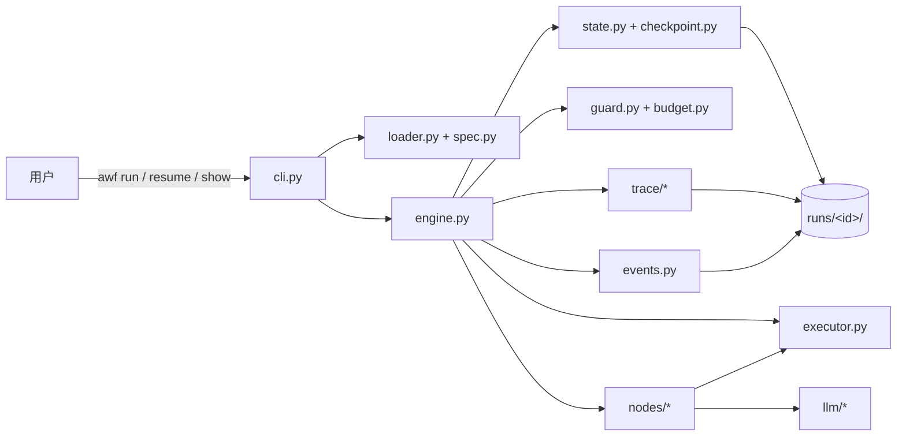
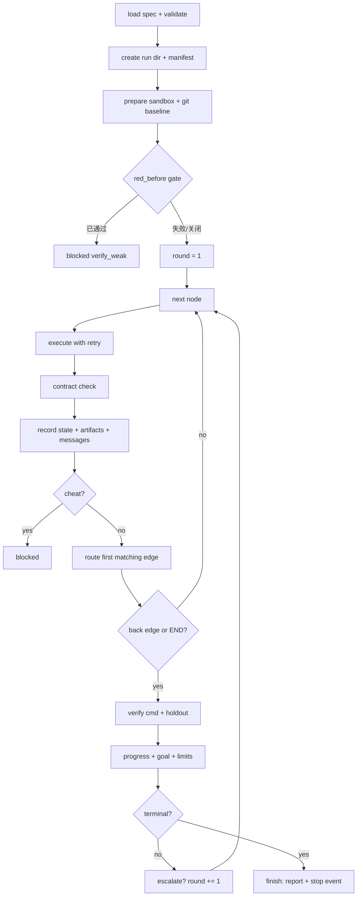

# 架构

## 1. 上下文图



一次 run 的目录是唯一的持久化事实来源：

```text
runs/<run_id>/
  manifest.json      # 不可变元数据
  state.json         # 当前检查点（原子替换）
  state.json.prev    # 上一个检查点，损坏时回退
  events.jsonl       # append-only 事件
  report.md summary.json flow.mmd sequence.mmd replay.html
  workdir/           # 沙箱副本（不是用户原目录）
  .lease             # RunLock 租约
```

`report.md` 的 Issues 表不只读取最终 artifact，而是按节点输出汇总每一次 review
（包括之后被同名 artifact 覆盖的第一次 review），并用 `resolved` 标明后续 clean
review 已解决的问题，因此“发现问题 → 修复 → 复审通过”的协作过程在报告里可见。

## 2. 分层与依赖方向

```text
cli -> loader/spec/expr
cli -> engine
engine -> state/checkpoint/contracts/guard/budget/events
engine -> nodes runtime -> llm/executor
engine -> trace
```

约束由 `tests/test_layering.py` 用 AST 扫描守护：

- HC-1：下层模块不得 import `engine` / `cli`；
- HC-2：`engine.py` 不得出现 coder/reviewer/fixer 等业务名；
- HC-3：业务节点只返回 `NodeResult`，不直接改 `RunState`。

## 3. 控制流



关键点：

- **轮次（round）** 不是节点步数。只有走过回边（DFS back edge）或到达
  END 时才结束一轮；这样 reviewer 之类的正向节点不会被误判为轮末。
- **重试** 在节点级：`retry: 1` 表示最多执行 2 次；契约不满足视同失败，
  尝试次数计入 `attempts`。
- **verify** 在轮末、goal 判定之前执行；`--no-verify` 只用于调试。
- **escalate** 在轮末触发：按配置切换模型/温度/rubric，次数受
  `escalate.max_times` 限制。

## 4. 状态模型

`RunState`（pydantic，schema_version=2）字段：

| 字段 | 含义 |
|---|---|
| `run_id/workflow/spec_hash/inputs` | 身份与输入 |
| `runtime` | round、counters、visit_count、streak、progress_trace、escalations、flags |
| `artifacts` | id -> `Artifact`（content + digest + producer） |
| `messages` | Agent 间 handoff/消息 |
| `history` | 每个节点的执行记录（状态、digest、usage、错误） |
| `outputs` | node -> JSON 输出，供表达式与下游节点使用 |
| `usage/budget` | token、成本、限额 |
| `verify` | 最近一次验证结果 |
| `terminal/stop_reason/failure_class/stop_detail` | 停止三元组 |
| `cursor` | 下一个待执行节点，用于 resume |

写入路径只有一个：`StateManager.record_result()` 与
`StateManager.finalize()`，避免"某条分支忘了记状态"。

## 5. 协作协议

Agent 之间**不共享可变对象**。信息通过两种载体流动：

1. **Artifact**：`patch`（unified diff）、`review`（结构化问题列表）等，
   带 digest，可被下游通过 `reads:` 引用；
2. **Message**：`StateManager` 在节点成功且声明了 `reads` 时，为每个被读取
   的 artifact 生成一条 handoff 记录，写入 `messages` 并发出 `message` 事件。

`workflows/bugfix.yaml` 的交接：

```text
coder  --patch-->  apply
apply  --patch-->  review
review --review->  fix          (blockers > 0)
fix    --patch-->  apply_fix
apply_fix --patch-> review_final
review_final --0---> END
review_final --patch-> fix      (blockers > 0, back edge)
```

`report.md` 的 "Collaboration" 表直接来自这些记录，`sequence.mmd` 则把
事件画成时序图。

### 5.1 内联 Agent

`llm_agent` 的 `impl` 可以省略，此时 prompt 全部写在 YAML 的
`config.system` / `config.task` 中（可选的 `config.normalize` 指向一个点分
Python 函数）。`loader.py` 在加载时校验：既没有 `impl` 也没有
`config.system` 的节点直接报 `SPEC_NODE_INVALID`。运行时与模块 Agent 完全
同一条路径：上下文组装、工具循环、artifact 生成、成本记账都不变。
`workflows/docsync.yaml` 的 analyst / writer / editor 即纯 YAML 三 Agent。

## 6. 沙箱与验证

- `LocalExecutor.prepare()` 把 `--workdir` 复制到
  `runs/<id>/workdir/`，忽略 `.git`、`.venv`、`__pycache__`、
  `.pytest_cache`、`runs` 等目录；
- `_init_git_baseline()` 在副本内 `git init` + 提交，并关闭
  `core.autocrlf`，确保 `git apply` 行为可预测；
- 拒绝符号链接，防止通过链接逃逸沙箱；
- 命令走白名单（`python`/`pytest`/`node` 等），不经过 shell；
- Windows 命令行用 `CommandLineToArgvW` 切分，避免引号被重复转义；
- 环境变量白名单，默认不把 API key 传给子进程；
- holdout 只在 `verify` 时复制进 `tests_holdout/`，Agent 工具期间不可见；
- 补丁在应用前经过 `patch_violations()`：绝对路径、`..` 穿越、空补丁，以及
  `tests/`、`tests_holdout/`、`conftest.py`、`pytest.ini`、`test_*.py` 等受保护
  路径都会被拒绝；违规时节点返回 `E-GUARD` 且 `cheat=True`，引擎直接
  `blocked`，不会调用 `git apply`；
- `red_before` 在**未修改副本**上先跑一次 verify，若已通过则拒绝开始，
  防止用"本来就绿"的测试冒充修复。

## 7. 恢复与并发

- `RunLock` 用 `O_CREAT|O_EXCL` 创建 `.lease`，30s 心跳；超过 120s
  无心跳视为陈旧，可被新进程接管并发出 `lease_stolen` 事件；
- 每次状态变化后 `RunStore.save()` 原子写：写临时文件 → fsync →
  旧文件复制为 `.prev` → `os.replace`；
- `resume` 校验 spec_hash 与 terminal，从 `cursor` 继续；已终态的 run
  明确拒绝；
- Ctrl+C 由 CLI 捕获，返回 130 并提示 `awf resume <run_id>`。

## 8. 可观测性

事件类型（节选）：

| 类别 | 事件 |
|---|---|
| 生命周期 | `run_start` `round_start` `resume` `cursor` `stop_decision` `run_end` |
| 节点 | `node_start` `node_end` `node_retry` `node_handler` `process_start` |
| 协作 | `artifact` `message` |
| LLM | `llm_call` `tool_call` `context_action` |
| 控制 | `converge_eval` `guard_trip` `escalate` |
| 验证 | `verify` `verify_red_before` |
| 系统 | `lease_stolen` `warn` `node_log` |

事件在进入总线时脱敏；单条事件超过 64 KiB 时只保留
`{truncated, bytes, keys}`。

## 9. 设计取舍

- **YAML 是唯一控制流**：避免"流程散落在 Python if/else"导致不可审计。
- **verify 在引擎内而不是 Agent 内**：模型不能自己宣布成功。
- **artifact 不可变 + digest**：重放、对比、审计都有稳定键。
- **一个 run 一个进程**：先用租约保证正确性；并发调度留给后续版本。
- **cassette 逐字节匹配**：离线测试优先保证确定性，提示词改动必须显式重录。

## 10. 六个演示覆盖的路径

| 演示 | 路径 | 停止结果 |
|---|---|---|
| `hello` | 顺序三节点 + goal | `success` |
| `bugfix` | 三 Agent + 条件分支 + 回边 + verify L4 | `success`（review 与 review_final 均执行） |
| `docsync` | 纯 YAML 三 Agent + write_file + verify L4 | `success` |
| `guard` | 补丁修改测试文件 | `blocked` / `cheat` |
| `falsepass` | 只改可见测试，holdout 仍失败 | `blocked` / `F-VERIFY-FALSEPASS` |
| `recover` | 第一次 patch 为空 → 条件边进入恢复节点 | `success` |

`python -m awengine demo` 依次执行并生成六份独立报告；`tests/test_demo.py`
把“预期成功/预期失败”的集合固定下来，防止改动演示时悄悄退回。
